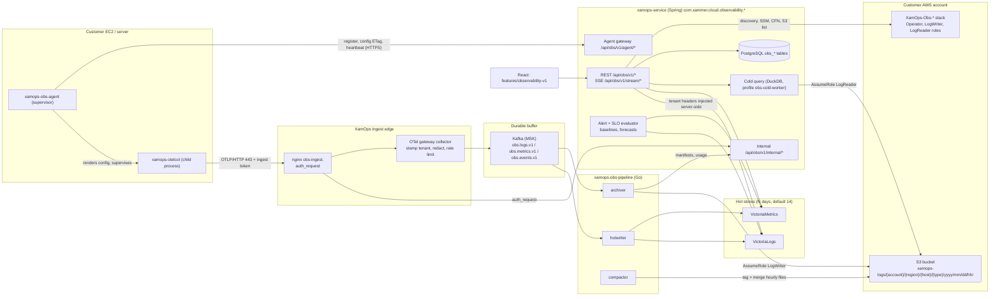

# XamOps Observability 1.0 ("XamPulse") — 02 Architecture

Status: design (planning only, no production code). Inputs: `00-inspection-notes.md` (verified repo facts), `01-research-report.md` (stack, agent decision). Companion docs: 03 onboarding/S3, 04 backend, 05 frontend, 06 data/API, 07 UI/UX, 08 roadmap/risks/tests.

Product working name: **XamPulse** (sidebar label "XamPulse", route namespace `/observability-v1/*`, API namespace `/api/obs/v1/*`). The name is a working title; it is a string constant (`OBS_BRAND` in `constants/tabs.ts`), so renaming is a one-line change (open decision D1 in 00-README).

## 1. Overview

XamPulse is a tenant-isolated telemetry product: **logs and deep host/container metrics now, traces later**. It has three parts.

1. **Edge:** a per-host supervisor (`xamops-obs-agent`, Go) that manages a trimmed OpenTelemetry Collector (`xamops-otelcol`). It pushes OTLP/HTTP over 443 (outbound only) to an ingest edge.
2. **Pipeline:** ingest edge (nginx `auth_request`), a gateway OTel Collector that stamps identity and redacts, Kafka as a durable buffer, and a Go service `xamops-obs-pipeline` with three roles (`hotwriter`, `archiver`, `compactor`). Hot data lands in VictoriaLogs and VictoriaMetrics. The authoritative archive lands in the **customer's S3** (or the XamOps-managed fallback bucket) as ZSTD Parquet in the requested layout.
3. **Control and query plane:** the existing Spring Boot service `xamops-service`, new package `com.xammer.cloud.observability.*` (control plane, query API, alert evaluator, smart features, SSE live tail) plus a React feature `frontend-app/src/features/observability-v1/`.

Hard separation: nothing here reads, calls or reuses the existing "Observability (Beta)" page, its routes, components or backend. Shared platform pieces used are exactly those in `00-inspection-notes.md` (see section 11).

## 2. Technology stack (locked on approval)

| Layer | Choice | Version policy |
|---|---|---|
| Host supervisor | Go, new entrypoint `ROOT/xamops-agent/cmd/obs-supervisor/` + `internal/obs/` in the existing `xamops-agent` module (Go 1.25, same `internal/version`) | Semver via ldflags |
| Host collector | OpenTelemetry Collector custom build (`ocb`), manifest `ROOT/xamops-agent/obs-otelcol/builder-config.yaml` | Pin one contrib version (latest stable at implementation; 0.164.0 was reported current on 2026-10-30 by the research and could not be verified from the repo, so verify the version at implementation), bump quarterly |
| Transport | OTLP/HTTP protobuf + gzip, port 443, header `X-XamOps-Ingest-Token` | n/a |
| Ingest edge | nginx (existing gateway stack) `auth_request` to Spring, host `obs-ingest.<domain>` | n/a |
| Gateway collector | Same `ocb` build, "gateway" config | Same pin |
| Buffer | Apache Kafka API (Amazon MSK). Topics `obs.logs.v1`, `obs.metrics.v1`, `obs.events.v1` | Open decision D2 (infra) |
| Hot logs | VictoriaLogs single node (v1.53.x per the research; verify the current release and flag names at implementation), cluster later | Apache-2.0 |
| Hot metrics | VictoriaMetrics single node with enforced labels for MVP, cluster edition at 1.0 GA | Apache-2.0 |
| Pipeline workers | Go module `ROOT/xamops-obs-pipeline` (new top-level dir): `cmd/hotwriter`, `cmd/archiver`, `cmd/compactor`; libs `segmentio/kafka-go`, `parquet-go/parquet-go`, `aws-sdk-go-v2` | Pin exact in go.mod |
| Cold query | DuckDB (MIT) via `org.duckdb:duckdb_jdbc` in Spring, activated by profile `obs-cold-worker`; optional Athena (existing `AwsClientProvider.getAthenaClient`) | Exact pin at implementation |
| Control-plane DB | PostgreSQL, Flyway, tables prefixed `obs_` | Existing |
| Cache / rate limit | Redis (existing) for token cache, SSE counters; Bucket4j (existing) | Existing |
| Backend | Java (Spring Boot of `xamops-service`), package `com.xammer.cloud.observability.*`, JPA entities, Spring MVC `SseEmitter` for live tail | Existing |
| Frontend | React 19, TS, Vite, Tailwind, react-router-dom 7, @tanstack/react-query 5, `cmdk` (already a dependency), `framer-motion` (already), recharts via CloudK8s shared charts, **uPlot** (new, MIT) for dense time series, `@tanstack/react-virtual` (new, MIT) for long lists | Exact-pin new deps |
| AI | LiteLLM-style gateway pattern already in repo (`docker-compose.litellm.yml`, `/api/ai/` in nginx); Obs calls a single `LlmGateway` interface; inspection of the platform LLM client is an implementation task (see D7) | n/a |

No AGPL component is in the data path (Loki, Mimir, Tempo, Grafana and similar AGPL stacks rejected in 01).

## 3. Architecture diagram

## 4. Component decisions

### 4.1 Host agent (decision restated, detail added)

Per 01 section 7: new supervisor binary in the existing `xamops-agent` repository plus a separate collector process. The legacy agent (`cmd/agent/main.go`) and its `/api/v1/agent/**` API are not modified. Details:

- **Files (agent repo):** `cmd/obs-supervisor/main.go`; `internal/obs/{enroll,identity,configfetch,render,supervise,heartbeat,update,uninstall,health,redactrules}/`; `scripts/obs_install.sh` (source of the served installer); `obs-otelcol/builder-config.yaml`; `Dockerfile.obs` (cross-builds `xamops-obs-agent_linux_{amd64,arm64}` and the collector; Windows `windows_amd64` at 1.0 GA).
- **Identity:** installer receives an **enrollment token** (not an ingest token). Supervisor calls `POST /api/obs/v1/agent/register` with IMDSv2 data (instance id, region, account id, AZ, instance type, tags if instance-metadata-tags is on, hostname, OS, arch, signed instance identity document). It receives a **per-host ingest token** (32 random bytes, shown once) and stores it in `/etc/xamops-obs/token` (mode 0600, owner `xamops-obs`). IMDSv2 only; no IMDSv1 fallback (an improvement over the legacy disk-agent helper, whose approach is reused, not its code path).
- **Config:** supervisor polls `GET /api/obs/v1/agent/config` with `If-None-Match` (default every 60 s, jittered), renders collector YAML from the desired-config JSON (06 section 9). No OpAMP in 1.0 (alpha). The JSON shape is OpAMP-mappable later.
- **Privileges:** runs as user `xamops-obs`, added to `adm` and `systemd-journal` groups for log reads; file ACL guidance for non-standard paths shown in the UI. Root is not used. Windows: service account with Event Log Readers.
- **Local safety:** collector `file_storage` persistent queue (default 512 MB, configurable, oldest-dropped with a counted metric `xo_agent_dropped_total`), `memory_limiter` (default 256 MiB soft cap), CPU nice 10 and `CPUQuota=25%` in the systemd unit, so the agent cannot starve the host.
- **Self-update:** supervisor downloads `manifest.json` + artifact from `/obs-agent/download/...` (302 to short-lived presigned URL), verifies SHA-256 (cosign/minisign signature verification added at 1.0 GA, D9), swaps atomically, runs a 120 s health gate, rolls back to previous binary on failure and reports `update-report`.
- **Uninstall:** `xamops-obs-agent uninstall` (also remote `uninstall` command and SSM document `XamOps-Obs-UninstallAgent`) stops units, removes binaries/config/token/queue, leaves nothing listening, and calls `POST /api/obs/v1/agent/uninstalled`.
- **Coexistence:** different units (`xamops-obs-agent.service`, `xamops-otelcol.service`), dirs (`/opt/xamops-obs`, `/etc/xamops-obs`, `/var/lib/xamops-obs`), token and ports. Collector listens only on `127.0.0.1:4317/4318` (loopback OTLP so apps can send custom metrics/traces locally) and `127.0.0.1:13133` health. No inbound port is opened.

### 4.2 Ingestion

1. Collector exports to `https://obs-ingest.<domain>/v1/logs|metrics|traces` with header `X-XamOps-Ingest-Token`.
2. nginx `auth_request /_obs_auth` calls `GET /api/obs/v1/internal/ingest-auth` (Spring, internal key), which hashes the token (SHA-256), looks up Redis (60 s TTL) then `obs_ingest_token`, and returns `204` with response headers `X-Obs-Client`, `X-Obs-Account` (cloud_account.id), `X-Obs-Host`, `X-Obs-Host-Key`, plus `X-Obs-Rate-Class`. On failure: `401` (unknown/expired/revoked) or `429` (host over its cap). nginx forwards the verified headers to the gateway and **strips any client-supplied `X-Obs-*` headers before the auth call**.
3. Gateway collector (`otlp` receiver with `include_metadata: true`) sets resource attributes `xo.client`, `xo.account`, `xo.host_id`, `xo.host_key` from the verified headers via the `resource` processor `from_context`, **overwriting** any same-named attribute in the payload. Then: `memory_limiter`, `transform` redaction (OTTL `replace_pattern`, rules from the tenant's `obs_redaction_rule` rows pushed via the internal API, plus a built-in baseline set), log-level normalisation, per-host rate limiting (token bucket) and sampling rules, then `kafka` exporter (`obs.logs.v1`, `obs.metrics.v1`; partition key `xo.client:xo.account`).
4. Back-pressure: nginx returns `429`/`503` with `Retry-After`; collectors retry from their persistent queue. Gateway has a disk queue (`file_storage`) in front of Kafka so a broker outage does not drop data for up to 30 minutes at the pilot rate.

### 4.3 Hot store

- **VictoriaLogs:** tenant = `AccountID = client_id`, `ProjectID = cloud_account_id` (both unsigned 32-bit; both are small BIGSERIAL values today, asserted at app start). `hotwriter` groups records per tenant and POSTs to `/insert/jsonline` with `AccountID`/`ProjectID` headers and `_stream_fields=host_key,service,type`. Retention is global (`-retentionPeriod=14d`, plus `-retention.maxDiskSpaceUsageBytes`). The browser never talks to VictoriaLogs; Spring is the only network path (security group/NetworkPolicy enforced) and injects the tenant headers per request. VictoriaLogs has no per-tenant authorization (01 fact check 4), so the invariant lives in `ObsVlClient` (single class, single place the headers are set; unit-tested).
- **VictoriaMetrics:** MVP single node; every series gets labels `xo_client` and `xo_account`; every read goes through `ObsVmClient`, which appends `extra_filters[]={xo_client="<id>",xo_account=~"<ids>"}` (VM-enforced, cannot be overridden by the query). 1.0 GA: cluster edition with `accountID=client_id`, `projectID=cloud_account_id` in the URL path; `ObsVmClient` hides the difference behind property `obs.vm.mode=single|cluster`.
- Hot metrics resolution: raw 10 s kept 14 days; 1-minute rollups for the archive; query steps below 10 s are rejected.

### 4.4 S3 cold / archive store

- `archiver` (Go) consumes `obs.logs.v1` and `obs.metrics.v1` (consumer group `obs-archiver`). It buffers per `(cloud_account_id, host_key_or_service, type, hour)` and flushes at 5 minutes or 64 MB (whichever first) to the destination returned by `GET /api/obs/v1/internal/archiver/destinations` (bucket, region, prefix, KMS key ARN, format, writer role ARN, external id), assuming `XamOpsObsLogWriter` in the customer account (credentials cached to expiry minus 5 min).
- **Key layout (exact, per requirement):** `s3://{bucket}/xamops-logs/{awsAccountId}/{region}/{host-or-service}/{type}/yyyy/mm/dd/hh/part-ca{cloudAccountId}-{yyyymmddhhmm}-{seq}.parquet`. `type` is one of `application|container|system|auth|web|windows-event|metrics`. `{host-or-service}` is the EC2 instance id (`i-0abc...`) for host-scoped logs, the sanitised hostname for non-EC2 servers, and `svc~{name}` for container logs whose service identity is known (ECS service, Kubernetes workload). Characters outside `[A-Za-z0-9._~-]` are replaced by `_`. Full contract and the JSON variant (`.jsonl.zst`) are in 03 section 6.
- **Format:** Parquet, ZSTD level 3, row group 128 MB-uncompressed, columns per 06 section 3.4 (fixed envelope + `attributes MAP<STRING,STRING>`). Per-destination option `jsonl_zst` for customers who want greppable files.
- **Compaction:** `compactor` merges the 5-minute parts of a closed hour into one `compact-ca{id}-{yyyymmddhh}.parquet`, then **tags** originals `xo-compacted=true` (writer role has `s3:PutObjectTagging`, deliberately no `s3:DeleteObject`). A lifecycle rule on tag `xo-compacted=true` expires them after 1 day. Queries prefer the compacted object when a manifest row says `compacted=true`.
- **Manifest index:** every flushed object produces a row in `obs_archive_manifest` (host, type, hour, key, bytes, row count, min/max ts, level counts) via `POST /api/obs/v1/internal/archiver/manifests`, and a small JSON sidecar `_manifest/ca{id}/yyyy/mm/dd/hh.json` in the bucket so the archive stays self-describing even if XamOps is gone. The cold planner and the storage-usage view read Postgres, so there are no S3 LIST calls in the hot UI path.
- **Fallback:** when no BYO destination exists or it is unhealthy, the archiver writes to the XamOps-managed bucket (`obs.managed-bucket.name`, property) under `managed/{clientId}/...` with SSE-KMS using a per-tenant data key (envelope, key alias `alias/xamops-obs-tenant-{clientId}` created lazily). The UI labels it "Managed by XamOps" and offers "Move to my bucket" (copy job, 03 section 9).
- **Failure semantics:** if S3 write fails (AccessDenied, NoSuchBucket, throttling), the archiver retries with backoff, holds offsets (Kafka retains 7 days), raises destination status `DEGRADED` after 10 minutes and `FAILED` after 60 minutes (UI banner + alert event `STORAGE_WRITE_FAILING`), and after 24 h of `FAILED` auto-diverts new data to the managed bucket **only if the customer enabled "safe fallback"** (default on, explained in the UI; D10).

### 4.5 Query API (Spring)

- **Multi-account fan-out (logs):** one VictoriaLogs request addresses exactly one tenant `(AccountID=client_id, ProjectID=cloud_account_id)`, but the UI scope can span several accounts. `ObsLogQueryService` therefore authorises each id, runs one upstream call per account in parallel (max 10 accounts, 8 s per call, 12 s total), and merges through `LogFanOutMerger`: rows by `(ts desc, id desc)`, histogram and facet counts summed, `stats` merged only for count/sum/min/max/top (else `STATS_NOT_MERGEABLE`), cursor = map of per-account cursors, partial failure reported as `partial: true` + `failedAccounts[]`. The live tail opens one upstream per account and merges them into one stream that counts as one against the stream limits. Metrics need no fan-out in single mode because VictoriaMetrics filters on `xo_client`/`xo_account` labels in one call (cluster mode fans out the same way as logs). Contract: 06 sections 5.4 and 10.
- **Hot logs:** `ObsLogQueryService` parses the user query with `XlqParser` (grammar in 06 section 8) into an AST, validates, injects scope, and compiles with `LogsQlCompiler` to LogsQL. Endpoints used on VictoriaLogs: `/select/logsql/query`, `/hits`, `/facets`, `/stats_query_range`, `/field_names`, `/field_values`, `/tail`.
- **Cold logs:** same AST goes to `DuckDbSqlCompiler` which emits parameterised SQL over `read_parquet([...file list from obs_archive_manifest...], union_by_name=true)` (or `read_json` for JSONL). No tenant-controlled string is concatenated into SQL; identifiers are validated against `^[A-Za-z_][A-Za-z0-9_.-]{0,127}$` and mapped to columns or `attributes['x']`. Execution is asynchronous (`obs_query_job`), with per-job memory limit (default 2 GB), thread cap (4), wall-clock cap (120 s), scan cap (default 20 GB per query, tenant-configurable down). The UI shows the planned file count and bytes **before** running (from manifests) and has a Cancel button.
- **Metrics:** `ObsMetricQueryService` compiles structured `MetricQuery` JSON (06 section 6) via `MetricsQlCompiler` using a metric catalog resource (`observability/metric-catalog.yaml`); an "advanced PromQL" mode exists for `obs.metrics.advanced` permission holders, parsed and checked against an allow-list of functions (no admin/federate endpoints; tenant filter forced).
- **Live tail:** `ObsLogTailController` (`GET /api/obs/v1/stream/logs/tail`, `text/event-stream`) validates and rejects unsupported stages before the stream starts, opens a streaming call to VictoriaLogs `/select/logsql/tail` per account, re-batches to ≤ 4 events/s with ≤ 200 lines/s, emits `heartbeat` every 15 s, ends after 30 min (the client, which reads the stream with fetch so error bodies are visible, reconnects with `Last-Event-ID`; exact events, errors and cursor rules in 06 section 10). The shared STOMP broker (`WebSocketConfig`) is **not** used (no tenant filter, per inspection note 0.6).
- **Correlation:** `POST /api/obs/v1/metrics/correlate` takes a metric point/range and returns a ready-made log query (same host(s), widened window ±2 min, level ≥ warn preselected) plus top co-moving metrics; the UI deep-links into the explorer (`/observability-v1/logs?...`).

### 4.6 Alerting, SLO, anomaly, forecasting (in-house)

- **Evaluator:** `ObsAlertScheduler` (`@Scheduled(fixedDelay = 15000)`) claims due rules with `SELECT ... FROM obs_alert_rule WHERE enabled AND next_eval_at <= now() ORDER BY next_eval_at LIMIT 200 FOR UPDATE SKIP LOCKED` (no ShedLock dependency; works with N replicas), evaluates in a bounded executor, writes `obs_alert_state` transitions, opens/updates `obs_incident` rows, and hands notifications to `ObsNotificationService`. Min rule interval 30 s.
- **Rule types:** `THRESHOLD`, `RATE_OF_CHANGE`, `ABSENCE`, `ANOMALY`, `LOG_PATTERN`, `COMPOSITE`, `FORECAST`, `SLO_BURN`.
- **Anomaly:** hour-of-week median/MAD baselines (`obs_baseline_stat`, computed nightly by `ObsBaselineJob` from 28 days of 5-minute data), score = robust z; sensitivity low/medium/high maps to 4.0/3.0/2.2 MAD. Every anomaly stores its explanation string.
- **Forecast:** `ObsForecastJob` (hourly) fits linear regression with seasonal residual check on 7 days of filesystem usage and memory (for leak: monotonic slope after removing GC sawtooth via lower envelope), writes `obs_insight` rows (`FORECAST_DISK_FULL`, `FORECAST_MEMORY_LEAK`) with ETA and confidence.
- **Noise reduction:** `ObsPatternMiner` (Drain-style template mining, in-house) runs on sampled hot logs per `(client, account, service)` every 5 minutes and maintains `obs_log_pattern`.
- **AI:** `ObsAiService` only receives pre-computed evidence (metric anomalies, new patterns, recent changes, top error samples already redacted and capped at 40 lines/6 KB). Output must cite evidence ids; ungrounded sentences are dropped by a post-check. Tenant toggle `obs_tenant_settings.ai_enabled` (default **off** until the customer opts in, D7). Nothing is sent to a model if the toggle is off.

### 4.7 Frontend

React feature in `frontend-app/src/features/observability-v1/` (05). One lazy-loaded shell, own nested `QueryClientProvider` (no persisted cache, so customer log lines never reach `localStorage`), URL-encoded state, SSE via native `EventSource` (cookie session), uPlot for dense series, shared CloudK8s primitives for cards, tables, drawers, status marks.

## 5. Multi-tenancy and isolation model

| Invariant | Where enforced | How |
|---|---|---|
| Ingest identity comes only from the token | nginx `auth_request` + gateway `resource` processor | Client `X-Obs-*` stripped; payload `xo.*` attributes overwritten. |
| Query identity comes only from the session | `ObsAccessGuard` (Spring) | `CloudAccountAccessService.requireAccess(user, id)` for every account in scope; client id taken from `ClientUserDetails.getClientId()`, never from a request body. |
| No cross-tenant read in hot stores | `ObsVlClient`, `ObsVmClient` | Headers / `extra_filters` set in exactly one class; only Spring can reach the stores. |
| No injection into LogsQL/MetricsQL/SQL | `XlqParser` AST + compilers | Values are escaped by the compiler; identifiers validated; raw PromQL gated and re-parsed. |
| S3 isolation | Customer bucket + role scoped to `xamops-logs/` prefix; managed bucket per-tenant prefix + KMS data key | Writer/Reader roles are separate; ExternalId = `cloud_account.external_id`. |
| Control-plane rows are tenant-scoped | Every `obs_*` table has `client_id` (and `cloud_account_id` where relevant); repositories expose only `...AndClientId` finders | Verified by a cross-tenant denial test suite (08 section 4). |
| Tokens are secrets | `IngestTokenService` | Stored as SHA-256 only, shown once, expiring 90 days, rotated by the supervisor with overlap. |
| Audit | `ObsAuditService` | Append-only `obs_audit_log` (DB trigger blocks UPDATE/DELETE), covers archive queries, exports, token and config changes, uninstalls. |

Note the repository runs in single-tenant DB mode (`TenantFilter` forces `"system"`), so isolation is by application checks and explicit `client_id` columns, not by schema routing.

## 6. Scale targets and cost estimates (planning assumptions, to be validated in the load-test spike)

Reference tenant mix: 100 hosts, 1.5 GB/day raw logs per host average, 250 metric series per host at 10 s, 14-day hot window, Parquet+ZSTD ratio ~10x.

| Item | Pilot (≤ 100 hosts total) | 1.0 GA design target (≤ 2,000 hosts total) | 2.0 (≤ 10,000 hosts) |
|---|---|---|---|
| Raw log ingest | 150 GB/day | 3 TB/day (≈ 35 MB/s) | 15 TB/day, cluster mode |
| Metric samples | 2.5k/s | 50k/s (500k active series) | 250k/s |
| Gateway collectors | 2 x 2 vCPU/4 GB | 4 x 4 vCPU/8 GB | autoscaled group |
| Kafka | 3 brokers small, 7 d retention | 3 brokers m5-class, 7 d | scale partitions |
| VictoriaLogs | 1 node 8 vCPU/32 GB, ~300 GB gp3 | 1 node 32 vCPU/128 GB, ~6 TB gp3 (vertical first) | cluster (vlinsert/vlselect/vlstorage) |
| VictoriaMetrics | 1 node 4 vCPU/16 GB | cluster, 3 vmstorage | scale-out |
| Archiver/hotwriter | 2 pods small | 6 pods | autoscale on lag |
| Cold query | 2 workers 4 vCPU/16 GB | 6 workers, per-tenant concurrency 2 | pool + Athena offload |
| Hot disk/day | ~21 GB | ~420 GB | n/a |
| Customer S3/month | ~450 GB first month ≈ $10 Standard (list ~$0.023/GB-mo us-east-1, region varies) | proportional, falling after IA/Glacier | n/a |

Cost visibility feature: usage meters (`obs_usage_hourly`: bytes in, lines, series, bytes archived per host and signal) drive the in-product "Cost" panel; list prices are read from the AWS Pricing API through `AwsClientProvider.getPricingClient()`.

Comparison context: for the pilot footprint, Datadog list prices (hosts + ingest) land in the multi-thousand-dollar monthly range and New Relic ingest alone about $1.7k at $0.40/GB (figures from the verified rates in 01 section 2.1). These are order-of-magnitude, not a quote.

## 7. Failure modes and degradation (system level)

| Failure | Behaviour | User-visible |
|---|---|---|
| Agent cannot reach ingest | Persistent queue on host (512 MB default); drop oldest beyond that and count drops | Host badge "Delayed", agent health detail "queue 38%, dropped 0" |
| Ingest auth service down | nginx fails closed (503, collectors retry) | Hosts show "No data since hh:mm" after 5 min |
| Kafka down | Gateway disk queue for ≤ 30 min | Banner only if > 5 min delay |
| VictoriaLogs down | Hot queries return `503 HOT_STORE_UNAVAILABLE`; archive keeps working; UI offers "Search archive instead" | Error state with action |
| Customer S3 AccessDenied | Destination `DEGRADED` → `FAILED`; managed fallback if enabled | Storage page banner + alert |
| Cold query too large | Rejected before run with scan estimate | "Narrow the range or add a host filter" |
| LLM unavailable | Smart panels degrade to non-AI statistics | "AI summary unavailable" chip |

## 8. Security architecture summary

- No inbound ports on customer hosts; outbound 443 only; TLS 1.2+.
- Least-privilege AWS: separate Operator, LogWriter and LogReader roles (03 section 3). Read-only default: installing the agent never modifies instance IAM; XamOps never attaches instance profiles.
- Secrets: ingest tokens hashed; enrollment tokens hashed, single/limited use, TTL; the legacy global agent key is never used.
- Redaction at host (first) and gateway (second) before any storage; custom rules with preview.
- PII-aware RBAC: separate permission `obs.logs.read` (see content) vs `obs.view` (see health and counts).
- Auditing, rate limits (Bucket4j on control plane), query cost guards.
- Security chain: a dedicated `SecurityFilterChain` bean at `@Order(0)` in `ObsSecurityConfig` claims only `/api/obs/v1/agent/**`, `/api/obs/v1/internal/**`, `/obs-agent/**` (so the existing `@Order(1)` impersonation chain, which would capture any `Authorization` header, never sees them). The existing `SecurityConfig.java` is **not edited**. Authenticated UI routes `/api/obs/v1/**` use the existing session chain (`anyRequest().authenticated()`).

## 9. Testability summary

Unit: parser/compilers, redaction rules, token service, scheduler state machine, forecast/baseline maths, IAM policy JSON generators. Integration (Testcontainers Postgres, already in the build): repositories, controllers with MockMvc and cross-tenant denial. Contract: recorded VictoriaLogs/VictoriaMetrics responses (WireMock). Pipeline: Go tests with a Kafka testcontainer and MinIO for the archiver. End-to-end: docker-compose profile `obs-e2e` (agent container → gateway → Kafka → VL/VM + MinIO). Details in 08 section 4.

## 10. Open technical risks carried into the plan

R-numbers refer to 08 section 3: trimmed collector size (R3), alpha components (R4), Kafka availability (R1), hot retention global (R6), VM tenancy (R7), Windows (R8), update signing (R9).

## 11. Shared platform pieces reused (verified paths)

All under `xamops-service/src/main/java/com/xammer/cloud/` unless noted: `config/SecurityConfig.java` (read-only reference; behaviour relied on), `security/ClientUserDetails.java`, `security/CloudAccountAccessService.java`, `domain/CloudAccount.java`, `repository/CloudAccountRepository.java`, `service/AwsClientProvider.java` (`getEc2Client`, `getS3Client`, `getSsmClient`, `getKmsClient`, `getCloudFormationClient`, `getEcsClient`, `getEksClient`, `getAutoScalingClient`, `getStsClient`, `getAthenaClient`, `getPricingClient`, `getHostS3Client`, `getRoleS3Client`), `controller/AccountManagerController.java` (`GET /api/xamops/account-manager/accounts` is what the frontend `AccountContext` consumes; Obs does not call it from the backend), `service/inventory/InventoryProjectionService.java`, `util/RemoteCommandInputValidator.java`, `ratelimit/` + `config/Bucket4jCacheConfig.java`, `config/CloudShellWebSocketConfig.java` (pattern only), `controller/AgentInstallController.java` (pattern only: classpath script serving), `controller/AgentController.java` (pattern only; not extended). Agent repo: `xamops-agent/internal/version/version.go`, IMDS helper approach in `xamops-agent/internal/collector/disk.go`. CloudFormation patterns: `cloudformation/xamops-readonly-role.yml`, `xamops-cur-export-nested.yaml`, `xamops-stack-updater.yml`. Frontend: `frontend-app/src/App.tsx`, `components/Sidebar/Sidebar.tsx` + `iconMap.ts`, `constants/xamopsTabs.ts`, `constants/xamsecureTabs.ts` (pattern), `utils/apiClient.ts`, `contexts/AccountContext.tsx`, `contexts/AuthContext.tsx`, `contexts/ThemeContext.tsx`, `components/CloudK8s/shared/**`, `components/ui/**`, `test/designRules.test.ts`. Gateway: `api-gateway/nginx-prod.conf`.

## 12. Responses to design review (iteration 2)
- Finding 8 (fixed): multi-account fan-out specified in 4.5; tail contract in 4.5 points to 06 section 10.
- Finding 9 (fixed): service name `ObsMetricQueryService` is now defined in 04; `DataDeletionJob` and the private internal upstream/listener are defined in 04 sections 2.7 and 5.
- Finding 10 (fixed): version pins carry a "verify at implementation" note in section 2.
