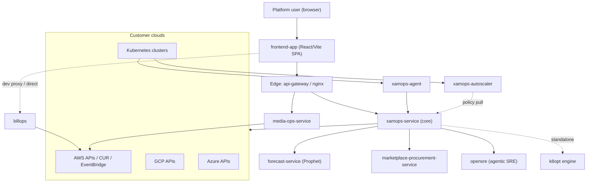
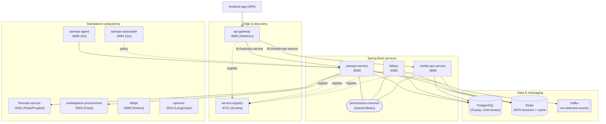

# 01 — System Overview

## What XamOps is

XamOps is a **multi-cloud operations SaaS** spanning three cloud providers (AWS, GCP, Azure)
and Kubernetes. From the code it combines several capability domains in one platform:

- **FinOps / cost** — cost explorer, CUR (Cost and Usage Report) ingestion and
  reconciliation, forecasting, rightsizing/waste, reservations, budgets and billing/invoices.
- **Cloud security posture** — compliance, DSPM, workload attack-surface review, Kubernetes
  security, and an Upwind integration ("XamSecure").
- **Inventory / resources** — a multi-cloud resource inventory ("cloudlist"/"cloudmap") and
  an inventory plane.
- **Kubernetes optimization** — EKS/GKE/AKS management, autoscaling, vertical rightsizing
  (in-cluster pod resize), and a standalone optimization engine.
- **Agentic SRE / AIOps** — detection + investigation pipelines, an AI advisor, a chatbot,
  and an LLM proxy.
- **Agents & metering** — in-cluster/on-host agents that push telemetry back, plus AWS
  Marketplace metering/procurement.
- **Media operations** — an FFmpeg-based media processing/streaming service.

The platform is a set of cooperating services written in **Java (Spring Boot 4 / Java 25)**,
**Python (Flask + Prophet / LangGraph)**, and **Go**, fronted by a **React 19 / Vite** SPA,
with **Spring Cloud Gateway** at the edge and **Netflix Eureka** for service discovery.

> Sources for this section: the Maven parent `pom.xml`, the per-module `pom.xml` files, each
> service's `application.properties`, `forecast-service/requirements.txt`, the Go `go.mod`
> files, and `frontend-app/package.json`. Specific citations appear in the inventory table
> below and throughout [02-service-architecture.md](02-service-architecture.md).

## Tech stack (verified)

| Layer | Technology | Evidence |
|---|---|---|
| Core backend | Spring Boot 4, Java 25, Spring MVC | `xamops-service/pom.xml`, root `Dockerfile` (`maven:3.9-eclipse-temurin-25` → `eclipse-temurin:25-jre`) |
| Edge | Spring Cloud Gateway (WebFlux / Netty) | `api-gateway/pom.xml` (`spring-cloud-starter-gateway-server-webflux`) |
| Discovery | Netflix Eureka Server | `service-registry/pom.xml` (`spring-cloud-starter-netflix-eureka-server`) |
| Forecasting | Python, Flask 3, Prophet, gunicorn | `forecast-service/requirements.txt`, `forecast-service/app.py` |
| Marketplace | Python, Flask 3, boto3 | `marketplace-procurement-service/requirements.txt` |
| Autoscaler / agent | Go (1.21 / 1.25), Kubernetes client-go | `xamops-autoscaler/go.mod`, `xamops-agent/go.mod` |
| K8s optimizer | Python 3.12 (stdlib) | `k8opt/Dockerfile`, `k8opt/pyproject.toml` |
| Agentic SRE | Python, LangGraph | `opensre/opensre-source/langgraph.json`, `pyproject.toml` |
| Frontend | React 19, Vite, TypeScript, Tailwind 3 | `frontend-app/package.json`, `frontend-app/vite.config.ts` |
| Data | PostgreSQL (Flyway), Redis, Kafka | `xamops-service/pom.xml`, `application.properties` |

## Service inventory

The Maven parent reactor (`pom.xml`) declares **only 6 modules**: `service-registry`,
`permissions-common`, `xamops-service`, `billops`, `media-ops-service`, `api-gateway`. The
Python, Go, `k8opt` and `opensre` subsystems are **standalone** (built/deployed
independently; they are not listed in the parent `<modules>`).

| Service | Language / Framework | Responsibility | Port | Repo path |
|---|---|---|---|---|
| **service-registry** | Spring Boot 4 / Eureka Server | Service discovery registry (`register-with-eureka=false`, `fetch-registry=false`) | **8761** | `service-registry/` |
| **api-gateway** | Spring Cloud Gateway (WebFlux) + Eureka client | Reactive edge; path-based routing to `lb://` targets | **8080** | `api-gateway/` |
| **xamops-service** | Spring Boot 4 / Java 25, Spring MVC | **Core** — multi-cloud FinOps, security, inventory, K8s, alerts, auth/tenant, SRE, agents (134 controllers) | **8080** | `xamops-service/` (artifact `cloud-dashboard`) |
| **billops** | Spring Boot 4 / Spring MVC | Billing/invoices, CUR ingest + reconciliation, tickets, credit requests, impersonation **signer** | **8082** | `billops/` |
| **media-ops-service** | Spring Boot 4 / Spring MVC + STOMP, FFmpeg | FFmpeg transcode, HLS/RTMP streaming, S3 media; impersonation **verifier** | **8084** | `media-ops-service/` |
| **permissions-common** | Shared Java library (Spring context + Redis) | Cloud permission-gap detection + Redis store + outbound SMS/WhatsApp RestClient; **not** a web app | n/a (library) | `permissions-common/` |
| **forecast-service** | Python / Flask 3 + Prophet | Prophet ML cost/usage forecasting | **5002** (local) | `forecast-service/` |
| **marketplace-procurement-service** | Python / Flask 3 + boto3 | AWS Marketplace catalog/agreements procurement API | **5003** | `marketplace-procurement-service/` |
| **xamops-autoscaler** | Go 1.21 / client-go + metrics | In-cluster K8s autoscaling (HPA/VPA/node optimize/evict/rebalance) driven by a policy fetched from xamops | **8081** (health) | `xamops-autoscaler/` |
| **xamops-agent** | Go 1.25 / client-go + DB drivers | In-cluster/on-host collector that pushes K8s/DB/disk/security/cost telemetry to xamops | **8080** (health) | `xamops-agent/` |
| **k8opt** | Python 3.12 (stdlib) | Standalone Kubernetes cost-optimization engine/operator + API | **8080** (container) | `k8opt/` |
| **opensre** | Python / LangGraph | Standalone agentic SRE investigation subsystem | **2024** (LangGraph API) | `opensre/opensre-source/` |
| **frontend-app** | React 19 / Vite / TS / Tailwind 3 | SPA; talks to backends via Vite dev proxy (dev) / nginx (EKS) | **5173** (dev) | `frontend-app/` |

**Port evidence:** 8761/8080/8082/8084 from each service's `application.properties`
(`server.port`); forecast 5002 from `xamops-service/.../application-local.properties`
(`forecast.service.url=http://localhost:5002`); marketplace 5003 from
`marketplace-procurement-service/Dockerfile` (`ENV PORT=5003`, `EXPOSE 5003`) and `app.py`
(`int(os.getenv('PORT', 5003))`); autoscaler 8081 from `xamops-autoscaler/cmd/autoscaler/main.go`
(`http.ListenAndServe(":8081", mux)`) and `xamops-autoscaler/Dockerfile` (`EXPOSE 8081`);
agent 8080 from `xamops-agent/internal/config/config.go` (`HealthPort` default `8080`, env
`HEALTH_PORT`); k8opt 8080 from `k8opt/Dockerfile` (`EXPOSE 8080`, `--serve --port 8080`);
opensre 2024 from `opensre/opensre-source/Dockerfile` (`EXPOSE 2024`); frontend 5173 is the
Vite dev default (`frontend-app/vite.config.ts`).

> **Note:** `api-gateway` and `xamops-service` both declare port 8080. They run as separate
> containers/pods, so this is not a conflict at runtime. In EKS, the React SPA's nginx proxies
> directly to `xamops-service:8080` rather than through the gateway (see
> [05-deployment-infrastructure.md](05-deployment-infrastructure.md) and
> `eks/manifests/06-frontend.yaml`).

## System context (level 1)

> Edges marked dotted are either direct (non-gateway) paths or subsystems whose in-process
> wiring to xamops could not be confirmed from code (see
> [02-service-architecture.md](02-service-architecture.md) for `k8opt` and `opensre` caveats).

## Container diagram (level 2)

The data-tier, integration edges and per-service responsibilities are expanded in
[02-service-architecture.md](02-service-architecture.md),
[04-data-architecture.md](04-data-architecture.md) and
[05-deployment-infrastructure.md](05-deployment-infrastructure.md).
