# 03 — Application Flow

This is the centerpiece: end-to-end request flows through XamOps, each as a Mermaid
`sequenceDiagram` grounded in the controllers, clients and config actually read. Each flow
names the files that back it. Participants or edges that could not be confirmed from source are
marked **(unverified)**.

---

## 3.1 User login / authentication

Form login terminates in `xamops-service`. The security chain is defined in
`config/SecurityConfig.java` (`formLogin` → `loginPage("/login")`,
`.successHandler(authenticationSuccessHandler)`), with custom handlers in `security/Custom*.java`,
a `CustomUserDetailsService` (bcrypt), and 14-day remember-me (key `app.remember-me.key`).
Sessions are backed by Redis (`spring-session-data-redis`). SSO variants exist via
`GoogleAuthController` / `MicrosoftAuthController`.

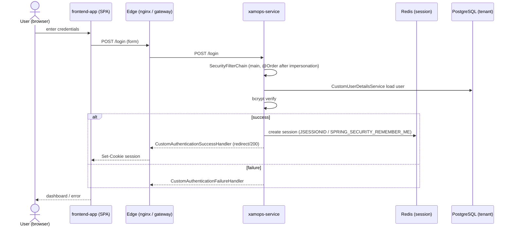

> Backing files: `xamops-service/src/main/java/com/xammer/cloud/config/SecurityConfig.java`
> (formLogin at `:335`, loginPage `:336`, successHandler `:337`),
> `security/CustomUserDetailsService`, `security/CustomAuthenticationSuccessHandler` /
> `...FailureHandler`, `controller/LoginOtpController.java`, `controller/PasswordResetController.java`.
> CSRF is disabled on the chain (`csrf.disable()`), documented in
> [06-cross-cutting-concerns.md](06-cross-cutting-concerns.md).

---

## 3.2 Cloud-account onboarding

Onboarding is driven by `AccountManagerController`, which also exposes a **public**
(`permitAll`) EventBridge callback used by the customer's AWS account after the onboarding
CloudFormation stack is deployed. The onboarding IAM roles are the CloudFormation templates
under `cloudformation/` (`xamops-readonly-role*.yml`, `xamops-readwrite-role*.yml`).

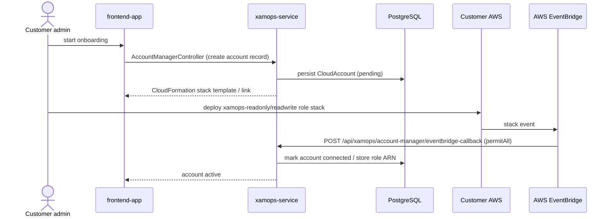

> Backing files: `controller/AccountManagerController.java` (EventBridge callback),
> `config/SecurityConfig.java` (the callback path is in the `permitAll` block),
> `cloudformation/xamops-readonly-role*.yml`, `cloudformation/xamops-readwrite-role*.yml`.

---

## 3.3 Dashboard / cost data read

Dashboard and cost reads go through `DashboardController` / `CostController` / `FinOpsController`.
These paths are rate-limited (bucket4j over jcache/Caffeine for `^/api/dashboard.*`) and served
from cached snapshots held in the `cached_data` table (large JSON stored as a legacy LOB/OID
TEXT column via `LegacyLobTextType`), falling back to live cloud SDK calls when the cache is
cold.

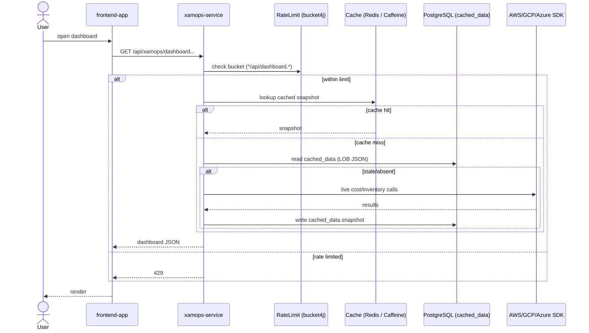

> Backing files: `controller/DashboardController.java`, `controller/CostController.java`,
> `controller/FinOpsController.java`, `ratelimit/` package, `config/SecurityConfig.java`
> (rate-limit matcher), `domain/CachedData` + the `LegacyLobTextType` LOB mapping (see
> [04-data-architecture.md](04-data-architecture.md)).

---

## 3.4 Async / scheduled data ingestion

Background ingestion is driven by `@Scheduled` jobs configured through `config/SchedulingConfig.java`,
`config/SchedulingEnvironmentConfig.java` and `config/AsyncConfig.java`. These include AWS
inventory reconcile (`xamops.inventory.sync-interval-ms=300000`), SQS event polling
(`xamops.inventory.events.*`), AutoSpotting SQS, disk/security-finding schedulers, agent data
cleanup/silence alerts, and forecast-accuracy jobs. Intervals come from
`xamops-service/src/main/resources/application.properties`.

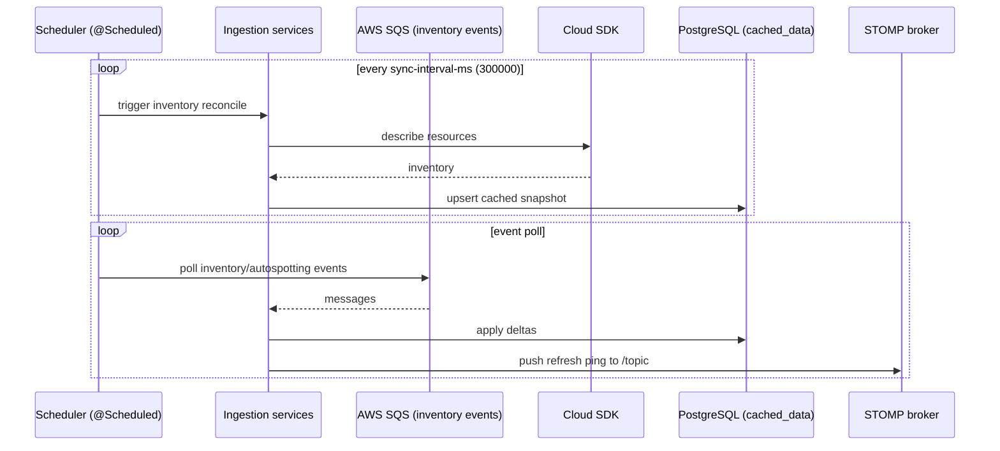

> Backing files: `config/SchedulingConfig.java`, `config/SchedulingEnvironmentConfig.java`,
> `config/AsyncConfig.java`, and the `xamops.inventory.*` / `xamops.inventory.events.*` keys in
> `application.properties`.

---

## 3.5 WebSocket / real-time updates

`xamops-service` exposes a STOMP endpoint at `/xamops-ws` (SockJS). `/topic` destinations are
broadcast (e.g. dashboard inventory refresh pings); `/queue` destinations are user-targeted via
`convertAndSendToUser` (call signals at `/user/{id}/queue/calls`, security findings at
`/user/{id}/queue/security-findings`). Call signalling uses `call/CallController` and
`call/CallSignalController` (LiveKit), with `websocket/CallStompAuthInterceptor` on connect.

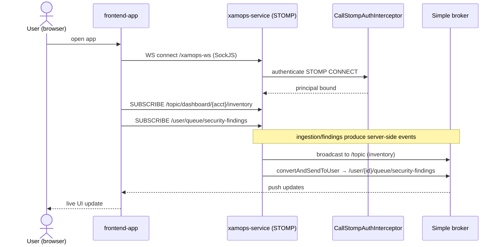

> Backing files: `config/WebSocketConfig.java` (endpoint `/xamops-ws` `:27`, SockJS `:29`,
> broker design notes `:34`–`:42`), `websocket/CallStompAuthInterceptor.java`,
> `websocket/CallPresenceListener.java`, `controller/call/CallController.java`,
> `controller/call/CallSignalController.java`.

---

## 3.6 SRE detection via Kafka

SRE auto-detection is produced to and consumed from a Kafka topic. `AutoDetectionService`
publishes to the topic (`sre.kafka.topic`, default `sre.detection.events`) keyed by a partition
key; `SreDetectionConsumer` listens on the same topic with manual ack via a dedicated listener
container factory. Consumer group is `sre-rca-consumer`.

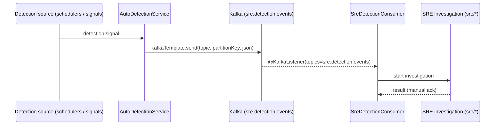

> Backing files: `config/KafkaConfig.java` (consumer group `sre-rca-consumer` `:46`),
> `service/sre/AutoDetectionService.java` (topic value `:50`, `kafkaTemplate.send` `:173`),
> `service/sre/SreDetectionConsumer.java` (`@KafkaListener` topics
> `${sre.kafka.topic:sre.detection.events}` `:42`–`:44`),
> `controller/sre/SreDetectionController.java`, `controller/sre/SreInvestigationController.java`.

---

## 3.7 Impersonation ("Login As") — cross-service

billops **signs** an impersonation JWT (`ImpersonationTokenController`, secret
`app.impersonation.secret-key`); xamops and media-ops **verify** it through a dedicated
STATELESS filter chain ordered first (`@Order(1)`), implemented by `ImpersonationJwtFilter`.

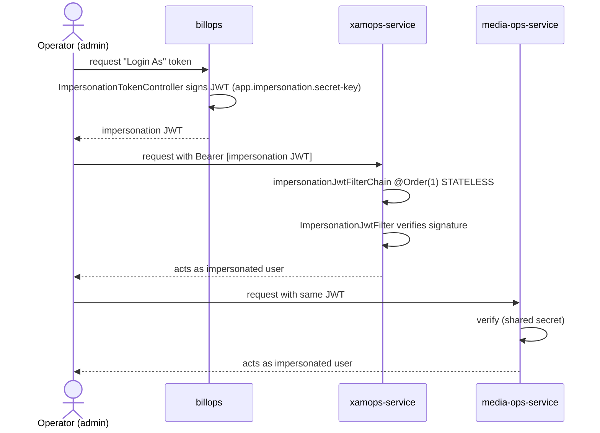

> Backing files: `config/SecurityConfig.java` (`impersonationJwtFilterChain` `@Order(1)` `:83`,
> STATELESS `:99`, filter wiring `:108`), `config/multitenancy/ImpersonationJwtFilter.java`,
> `security/JwtTokenProvider.java` / `security/JwtTokenFilter.java`; billops
> `controller/ImpersonationTokenController.java`; media-ops `app.impersonation.secret-key` in
> `media-ops-service/src/main/resources/application.properties`.

---

## 3.8 billops — CUR ingestion + reconciliation + dashboard read

`CurIngestionService` reads a customer's CUR 2.0 export from S3 and writes `AWS_CUR_*` rows into
the **shared** `cached_data` table (shared with xamops); closed months are reconciled against
Cost Explorer. `CurSnapshotScheduler` / `DashboardCacheScheduler` refresh snapshots. The billops
dashboard reads back from `cached_data`.

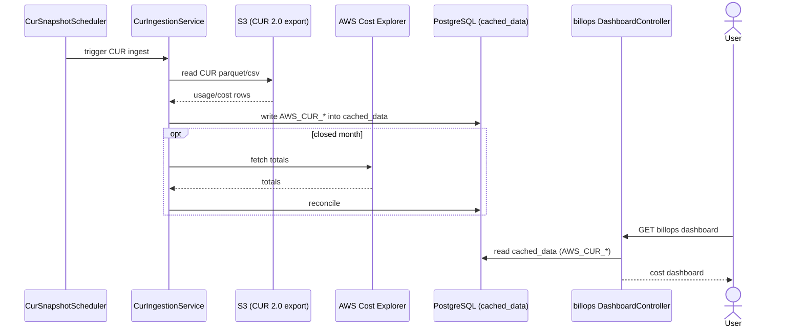

> Backing files: `billops/src/main/java/com/xammer/billops/service/CurIngestionService.java`,
> `billops/.../service/CurSnapshotScheduler`, `DashboardCacheScheduler`,
> `billops/.../controller/DashboardController.java` / `CurAdminController.java`,
> `billops/src/main/resources/application.properties` (`billops.cur.enabled=true`).

---

## 3.9 media-ops — transcode submit → progress → output

A transcode job is submitted via `MediaOpsController` / `BatchController`, queued by
`PriorityQueueService`, processed by `TranscodeJobService` + `FFmpegService`, with progress
pushed over STOMP `/media-ops-ws` (`/topic`), and output stored via
`MediaStorageService`/`S3StorageService` and served under `/media/*`.

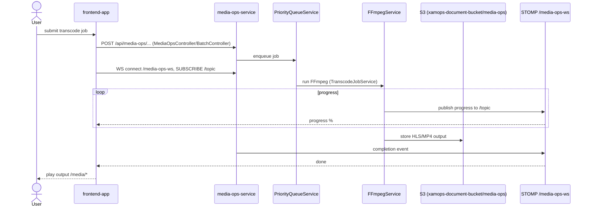

> Backing files: `media-ops-service/.../controller/MediaOpsController.java`, `BatchController.java`,
> `media-ops-service/.../service/{TranscodeJobService,FFmpegService,PriorityQueueService,MediaStorageService}.java`,
> `media-ops-service/.../config/WebSocketConfig.java`.

---

## 3.10 api-gateway — edge routing

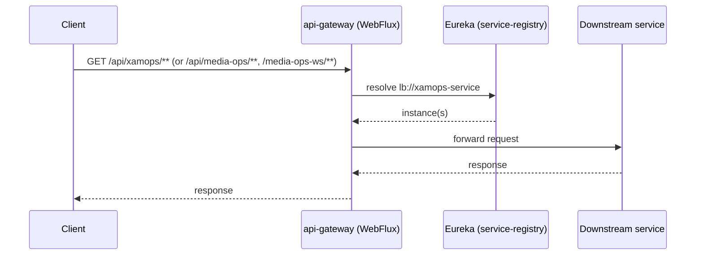

> Backing files: `api-gateway/src/main/resources/application.properties` (routes `[0]`–`[2]`,
> `lb://` URIs). Reminder: no billops route exists at the gateway (§2.4).

---

## 3.11 service-registry — registration & discovery

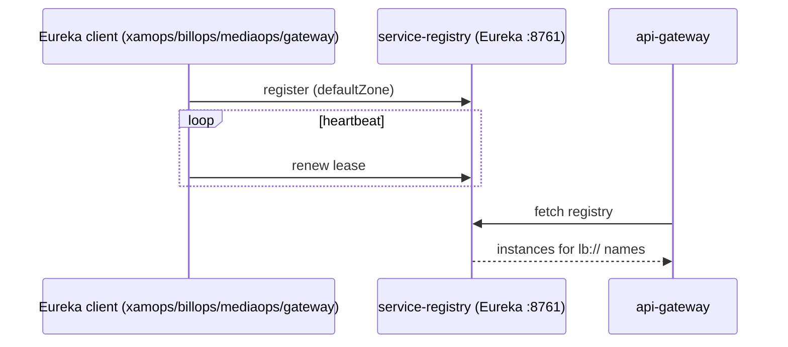

> Backing files: `service-registry/src/main/resources/application.properties`
> (`register-with-eureka=false`, `fetch-registry=false`), each client's `eureka.client.service-url.defaultZone`.

---

## 3.12 permissions-common — permission-gap detection

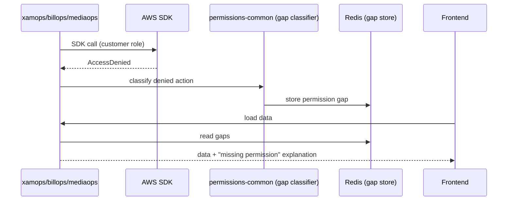

> Backing files: `permissions-common/pom.xml` (role + Redis + AWS deps). The concrete
> interceptor/consumer class names are **(unverified)**; the gap-classification edge is
> inferred from the library's description and dependencies.

---

## 3.13 forecast-service — cost forecasting

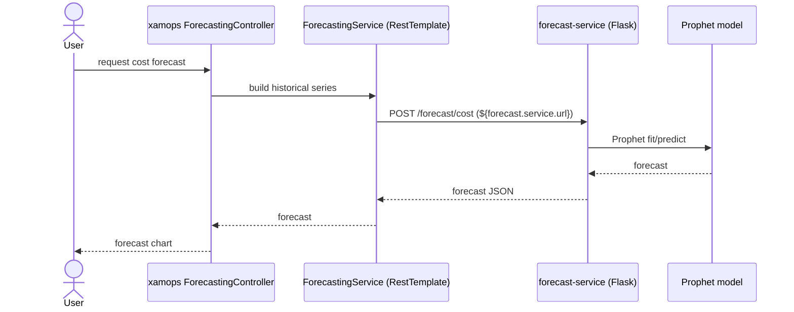

> Backing files: `xamops-service/.../service/ForecastingService.java` (RestTemplate →
> `${forecast.service.url}`), `forecast-service/app.py` (`/forecast/cost` `:60`, `/forecast/usage`
> `:138`), `forecast-service/models/prophet_forecaster.py`.

---

## 3.14 marketplace-procurement-service — procurement

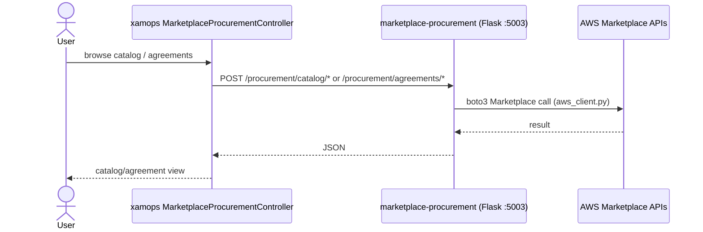

> Backing files: `xamops-service/.../controller/MarketplaceProcurementController.java` /
> `MarketOpsController.java`, `marketplace-procurement-service/app.py`,
> `marketplace-procurement-service/aws_client.py`. The exact Java HTTP client class is
> **(unverified)**.

---

## 3.15 xamops-autoscaler — policy-driven autoscaling loop

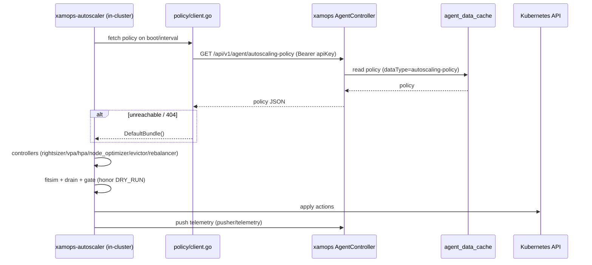

> Backing files: `xamops-autoscaler/internal/policy/client.go`,
> `xamops-autoscaler/cmd/autoscaler/main.go` (DRY_RUN, in-cluster config),
> `xamops-service/.../controller/AgentController.java` (`GET /autoscaling-policy`).

---

## 3.16 xamops-agent — collect → push ingestion

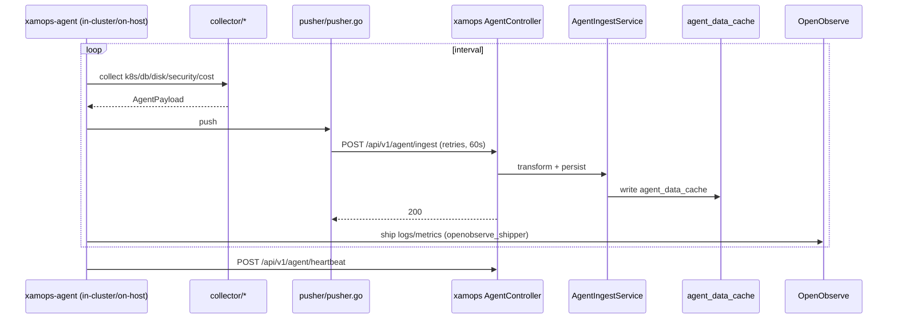

> Backing files: `xamops-agent/internal/pusher/pusher.go` (POST `/api/v1/agent/ingest`),
> `xamops-agent/internal/collector/openobserve_shipper.go`,
> `xamops-service/.../controller/AgentController.java` (`/ingest`, `/heartbeat`),
> `xamops-service/.../service/AgentIngestService.java`.

---

## 3.17 k8opt — Kubernetes rightsizing (standalone engine)

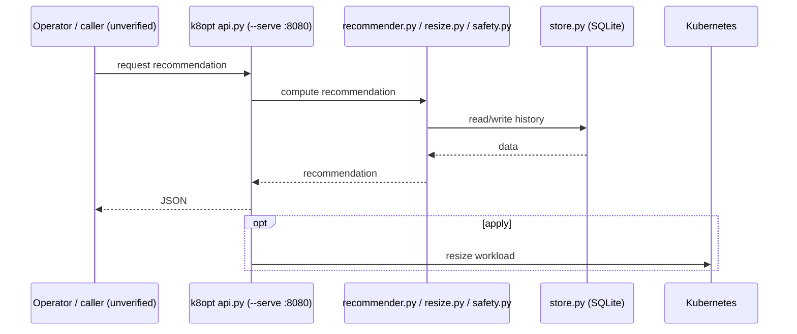

> Backing files: `k8opt/Dockerfile` (`--serve --port 8080`), `k8opt/k8optimizer/{server,api,recommender,resize,safety,store}.py`.
> **Caveat:** no xamops HTTP client calling this API was found; xamops' own pod-resize path is
> in-process via `service/automation/workload/execute/PodResizeClient.java`. The caller is
> **(unverified)**.

---

## 3.18 opensre — agentic SRE investigation (standalone subsystem)

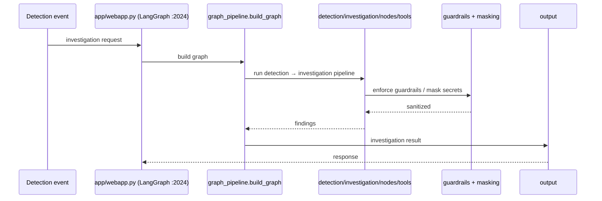

> Backing files: `opensre/opensre-source/langgraph.json`, `opensre/opensre-source/app/graph_pipeline.py`
> (`build_graph`), `app/webapp.py`, `app/{detection,nodes,tools,guardrails,masking}/`.
> **Caveat:** platform wiring to xamops is **(unverified)**.

---

## 3.19 frontend-app — SPA request to backend

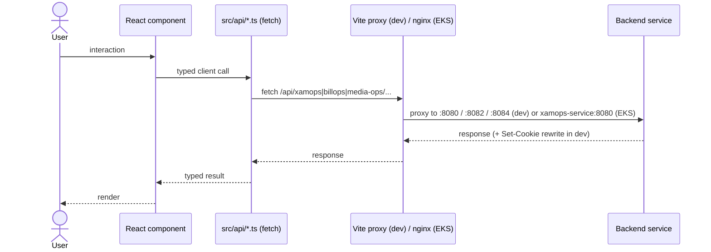

> Backing files: `frontend-app/vite.config.ts` (dev proxy + cookie rewrite),
> `frontend-app/src/api/*.ts`, `eks/manifests/06-frontend.yaml` (EKS nginx proxy to
> `xamops-service:8080`).
