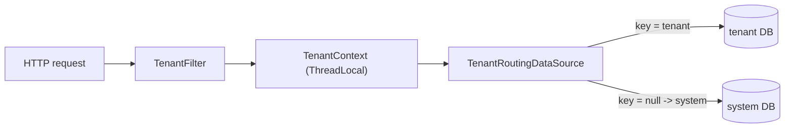
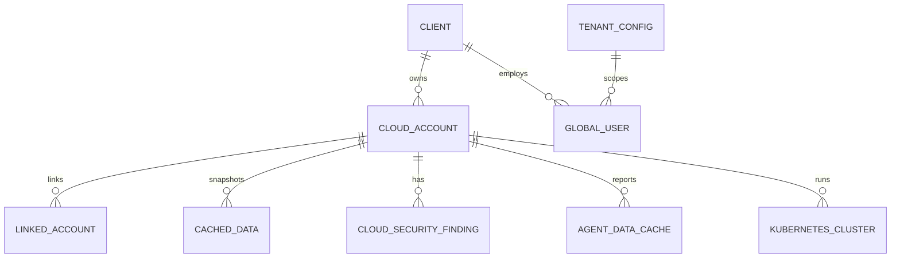

# 04 — Data Architecture

## Database engine

The platform runs on **PostgreSQL**. `xamops-service` uses the PostgreSQL dialect, with schema
managed by **Flyway** (not Hibernate DDL):

- `spring.jpa.database-platform=org.hibernate.dialect.PostgreSQLDialect`
- `spring.jpa.hibernate.ddl-auto=none`

(`xamops-service/src/main/resources/application.properties:23`–`24`). The HikariCP pool is
tuned there too (`maximum-pool-size=20`, `minimum-idle=5`, `connection-test-query=SELECT 1`,
lifetimes/timeouts at `:77`–`:97`).

## Multi-tenant model (shared catalog + per-tenant routing)

XamOps uses **runtime tenant routing** over `AbstractRoutingDataSource`. The current tenant is
held in a `ThreadLocal` (`TenantContext`) and resolved per request by a filter; the routing
datasource picks the physical datasource from that key.

- `TenantRoutingDataSource extends AbstractRoutingDataSource`; `determineCurrentLookupKey()`
  returns `TenantContext.getCurrentTenant()`, and when the context is null it falls back
  explicitly to the `"system"` datasource (it does not rely on `lenientFallback`). Source:
  `config/multitenancy/TenantRoutingDataSource.java:7`,`:12`–`:17`.
- Supporting classes (`config/multitenancy/`): `MultiTenantDataSourceConfig`, `TenantContext`,
  `TenantContextUtil`, `TenantFilter`, plus the impersonation context/filters
  (`ImpersonationContext`, `ImpersonationFilter`, `ImpersonationJwtFilter`).
- Per-tenant connection details live in a `tenant_config` table and users are scoped by a
  tenant id — the design introduced by `database-migration-tenant-refactor.sql` (root of repo).
- Logging carries the tenant in MDC (`logging.pattern.console` in `application.properties`).

## JPA entity catalog

The domain model is large: **112 JPA entity classes** (measured) under
`xamops-service/src/main/java/com/xammer/cloud/domain/`, with Spring Data repositories under
`repository/`. Representative entities (names confirmed as files in `domain/`):

| Area | Representative entities |
|---|---|
| Tenancy / identity | `Client`, `CloudAccount`, `LinkedAccount` |
| Cache / snapshots | `CachedData`, `AgentDataCache` |
| Security | `CloudSecurityFinding` |
| Scheduling | `CloudsitterPolicy` |
| Kubernetes | `KubernetesCluster` |
| Marketplace / metering | `IsvProduct` |
| FinOps | `FinOpsReportSchedule` |
| DB ops | `DbHealthSnapshot` |
| Integrations | `GitHubIntegrationConfig`, `SonarQubeProject` |

This is a representative slice, not the full list of 112 — browse `domain/` for the complete
set.

### Legacy large-object (LOB/OID) columns

Several columns store large text/JSON as PostgreSQL large objects (OID) and are mapped through
a custom Hibernate type, `LegacyLobTextType`, with a write-mode flag and a shape guard
(`domain/type/{LegacyLobTextType,LobTextWriteMode,OidShapeGuard}.java`). Confirmed entities
using it:

- `CachedData` (`domain/CachedData.java`) — the dashboard/cost snapshot JSON.
- `CloudsitterPolicy` (`domain/CloudsitterPolicy.java`) — schedule JSON.
- `SonarQubeProject` (`domain/SonarQubeProject.java`) — encrypted token.
- `GitHubIntegrationConfig` (`domain/GitHubIntegrationConfig.java`) — encrypted PAT.

A root SQL script (`database_migration_cached_data_lob_oid_repair.sql`) exists to repair these
OID columns.

## Migrations

### Flyway (in-service)

**90 scripts** (measured) in `xamops-service/src/main/resources/db/migration/`, versioned from
`V1__Create_linked_accounts_table.sql` through `V20261013_1__vertical_workload_action.sql`
(there is also an `INDEX_DOCUMENTATION.md` in that folder). Flyway is wired via
`spring-boot-starter-flyway` + `flyway-database-postgresql` (`xamops-service/pom.xml`), and
because `ddl-auto=none`, Flyway is the sole source of schema truth.

### Root SQL migrations (data-model history)

Standalone SQL scripts at the repo root capture larger schema changes applied operationally:

- `database-migration-tenant-refactor.sql` — the multi-tenant refactor (tenant_config, scoped users).
- `database_migration_cached_data_lob_oid_repair.sql` — LOB/OID repair for `cached_data`.
- `database_migration_credit_request_attachments.sql`,
  `database_migration_credit_request_business_approval.sql`,
  `database_migration_credit_request_priority.sql` — billops credit-request schema.
- `database_migration_upwind_posture_drop_pass.sql` — XamSecure/Upwind posture.
- `database_migration_user_cloud_account_access.sql` — the user↔cloud-account access table (IDOR fix).
- `fix_user_schema.sql` — user-schema fix.

## Caching

- **Redis** (`spring-boot-starter-data-redis`, port 6379 —
  `application.properties:242`) backs HTTP sessions (`spring-session-data-redis`; session
  timeout `1d`, `application.properties:247`) and the shared permission-gap store
  (`permissions-common`). A Redis cache TTL of `14400000` ms (4h) is configured
  (`spring.cache.redis.time-to-live`, `application.properties:569`).
- **Caffeine / jcache** in-process cache (`spring-boot-starter-cache`) is used for rate-limiting
  buckets and short-lived caches.
- **`cached_data`** (PostgreSQL LOB) holds materialized dashboard/cost snapshots shared between
  xamops and billops (billops writes `AWS_CUR_*` rows; see
  [03-application-flow.md](03-application-flow.md) §3.8).

## Messaging — Kafka (SRE stream)

A single SRE detection stream is used:

- Topic: `sre.detection.events` (property `sre.kafka.topic`, defaulted in code).
- Producer: `service/sre/AutoDetectionService.java` (`kafkaTemplate.send(kafkaTopic, partitionKey, json)` `:173`).
- Consumer: `service/sre/SreDetectionConsumer.java` (`@KafkaListener(topics="${sre.kafka.topic:sre.detection.events}")` `:42`–`:44`), consumer group `sre-rca-consumer` (`config/KafkaConfig.java:46`), manual ack via `sreKafkaListenerContainerFactory`.

> The ER diagram shows relationships inferred from the entity names and the multi-tenant
> refactor SQL; exact foreign-key column names should be read from the Flyway scripts and
> `domain/*` classes when precision is needed. Cardinalities beyond the obvious ownership links
> are **(unverified)**.
