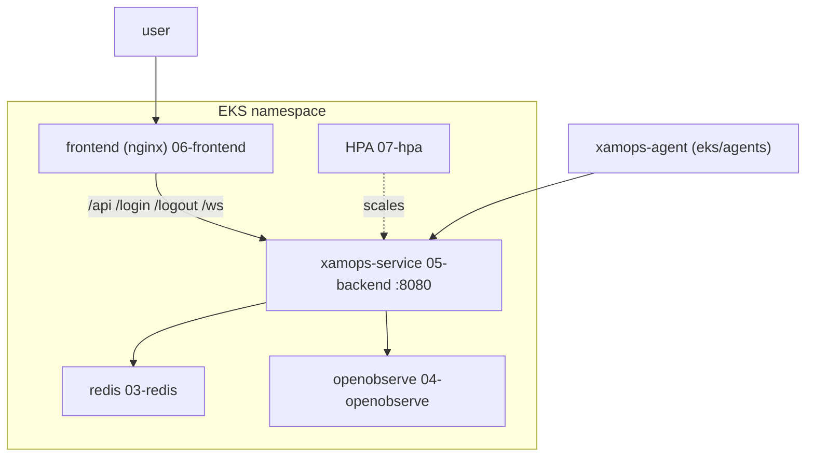

# 05 — Deployment & Infrastructure

Two distinct runtime topologies appear in the repo: a **docker-run on SIT EC2** path driven by
`Jenkinsfile`, and a **Kubernetes (EKS)** path under `eks/`. Standalone subsystems
(forecast-service, k8opt, opensre, the Go agent/autoscaler) ship with their own Dockerfiles and
manifests.

## Build images (Dockerfiles)

- **Root `Dockerfile`** — multi-stage Java build: stage 1 `maven:3.9-eclipse-temurin-25` runs
  `mvn clean package -pl ${MODULE_NAME} -am -DskipTests` (`Dockerfile:38`,`:45`–`:46`), copies
  the module jar to `/app/app.jar` (`:52`); stage 2 `eclipse-temurin:25-jre-jammy`
  (`:61`) exposes `ARG EXPOSE_PORT=8080` (`:111`–`:112`), `ENTRYPOINT ["java","-jar","app.jar"]`
  (`:118`), and a `HEALTHCHECK` hitting `/actuator/health` (`:121`). The `MODULE_NAME` build
  arg selects which Maven module is packaged, so one Dockerfile builds any of the Java services.
- Per-service Dockerfiles referenced by CI: `./service-registry/Dockerfile`, `./billops/Dockerfile`,
  `./xamops-service/Dockerfile`, `./frontend-app/Dockerfile`.
- Standalone: `forecast-service/Dockerfile`, `marketplace-procurement-service/Dockerfile`
  (`EXPOSE 5003`), `k8opt/Dockerfile` (`EXPOSE 8080`), `opensre/opensre-source/Dockerfile`
  (`EXPOSE 2024`), `xamops-autoscaler/Dockerfile` (`EXPOSE 8081`), `xamops-agent/Dockerfile`
  (`EXPOSE 8080`).

## CI/CD — `Jenkinsfile`

The pipeline builds and pushes **four** images to GHCR, then deploys over SSH to a SIT EC2
host.

| Stage | Action | Evidence |
|---|---|---|
| Checkout | SCM checkout | `Jenkinsfile:8` |
| Login to GHCR | `docker login ghcr.io` | `Jenkinsfile:12`–`:15` |
| Build & Push Images | parallel: `service-registry`, `billops`, `xamops-service`, `frontend-app` via `buildAndPush(...)` | `Jenkinsfile:20`–`:25` |
| Deploy to SIT | SSH to EC2, `docker pull` the 4 images, create `xamops-network`, `docker run` each | `Jenkinsfile:29`–`:59` |

Deploy details (`Jenkinsfile:46`–`:59`): `service-registry` on `-p 8761:8761`, `billops` on
`-p 8082:8082`, `xamops-service` on `-p 8080:8080 --restart always`, `frontend-app` on the
`xamops-network`. `REGISTRY = 'ghcr.io'` (`Jenkinsfile:5`).

> **Security flag (do not reproduce values).** `Jenkinsfile` contains a hardcoded SIT EC2 host
> address, `StrictHostKeyChecking=no`, and credential material echoed into `docker login`
> (`Jenkinsfile:15`,`:33`–`:34`). These are flagged in
> [06-cross-cutting-concerns.md](06-cross-cutting-concerns.md) as secrets-in-source; they
> should move to a credential store. The actual values are intentionally not copied here.
>
> **Note:** billops/xamops/media-ops are the three application services, but CI builds only
> service-registry + billops + xamops-service + frontend-app — `media-ops-service` and
> `api-gateway` are **not** in the Jenkins image build (they are present in the EKS path and
> the codebase). Document this asymmetry when planning releases.

## docker-compose (supporting infra)

At the repo root:

- `docker-compose.litellm.yml` — the LiteLLM LLM proxy used by xamops AI features.
- `docker-compose.livekit.yml`, `docker-compose.livekit.uat.yml`,
  `docker-compose.livekit.prod.yml` — LiveKit (used by the calls/realtime feature), per
  environment.

Standalone services carry their own compose files (e.g. `forecast-service/docker-compose.{local,sit,uat,production}.yml`,
`opensre/docker-compose.opensre.yml`).

## Kubernetes (EKS)

`eks/manifests/` is an ordered manifest set:

| File | Purpose |
|---|---|
| `00-namespace.yaml` | Namespace |
| `01-secrets.yaml` | Secrets |
| `02-configmap.yaml` | Config |
| `03-redis.yaml` | Redis |
| `04-openobserve.yaml` | OpenObserve (observability) |
| `05-backend.yaml` | `xamops-service` Deployment + Service (ECR image, `ap-south-1`) |
| `06-frontend.yaml` | Frontend (nginx proxies `/api/`, `/login`, `/logout`, WebSocket → `xamops-service:8080`) |
| `07-hpa.yaml` | Horizontal Pod Autoscaler |

There is also a UAT variant (`eks/manifests-uat/`), cluster config (`eks/cluster-config.yaml`,
`eks/cluster-autoscaler.yaml`), build/deploy scripts (`eks/build-and-push.sh`, `eks/deploy.sh`),
and agent manifests (`eks/agents/`). The backend image is pulled from ECR
(`<AWS_ACCOUNT_ID>.dkr.ecr.ap-south-1.amazonaws.com/xamops-service:latest`,
`eks/manifests/05-backend.yaml:31`).

## CloudFormation (customer-side onboarding & engines)

`cloudformation/` holds the stacks a customer deploys into their own account plus platform
engines:

- **Onboarding roles:** `xamops-readonly-role.yml` (+ `-local`, `-uat`, `-uat-no-inventory`
  variants), `xamops-readwrite-role.yml` (+ `.live`, `.local`, `-uat` variants).
- **AutoSpotting:** `autospotting-customer.yaml`, `autospotting-customer-account.yaml`,
  `autospotting-engine.yaml`.
- **Inventory engine:** `xamops-inventory-engine.yaml`, `xamops-inventory-events-nested.yaml`.
- **CUR export:** `xamops-cur-report.yml`, `xamops-cur-export-nested.yaml`, `xamops-mpa-cur-role.yml`.
- **ISV metering:** `xamops-isv-metering-role.yml`.
- **Stack lifecycle / deployer:** `xamops-deployer-policy.json`, `xamops-stack-updater.yml`,
  `xamops-upgrade.yml`.

These back the onboarding flow in [03-application-flow.md](03-application-flow.md) §3.2.

## Environments

Per-service Spring profiles are provided via `application-<profile>.properties`. Observed
profiles include `local`, `uat`, `preprod`, `prod` (and `sit` for billops). The LiveKit compose
files are split `uat`/`prod`; the EKS manifests have a base + `manifests-uat` variant; the
Jenkins target is SIT. Choose the activated profile with `spring.profiles.active` /
`SPRING_PROFILES_ACTIVE`.
